<p align="center">
  
</p>

<p align="center">
  
</p>

<p align="center">
  
  
  
  
</p>

## Overview

A collection of React exam exercises kept together in one repository. It contains a project-management practice app and a quiz app, each in its own folder with its own Vite setup.

## Highlights

- project/examen — project-management practice app with json-server
- reactquiz — quiz practice app
- Independent package setups per exercise

## Tech stack

<p align="center">
  
</p>

## Getting started

**Prerequisites:** Node.js 20+.

```bash
cd project/examen
npm install
npm run dev

cd ../../reactquiz
npm install
npm run dev
```

## Project structure

```text
project/examen/   project-management exercise
reactquiz/        quiz exercise
```

---

<p align="center">
  
</p>

<p align="center">
  Built by <a href="https://github.com/Skander-Bardaoui"><b>Skander Bardaoui</b></a> ·
  <a href="https://skander-bardaoui.netlify.app/">Portfolio</a> ·
  <a href="https://github.com/Skander-Bardaoui?tab=repositories">All repositories</a>
</p>
